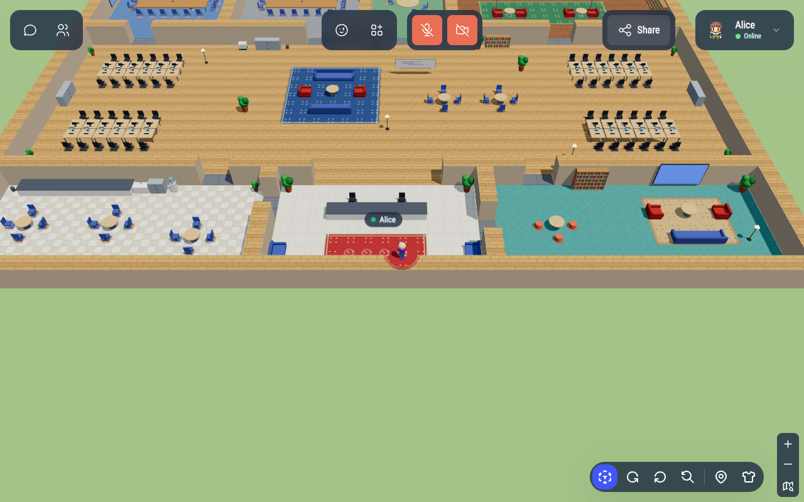

# The 3D world

WorkAdventure can display any map in 3D, with customizable 3D avatars. It changes how the world looks, not how it
works: meetings, areas, scripting, the map editor and everything else behave exactly as in the classic 2D view.



## For users

- **Switching views**: the cube button at the bottom right of the screen switches between the 3D and the 2D view.
  The choice is remembered. A link can force a view with the `view` URL parameter (`?view=3d` or `?view=2d`).
- **Game camera** (default): a third-person camera over the shoulder of your avatar, like in action games. The
  arrow keys / WASD move relatively to the camera (up = forward), drag with the mouse to look around, and the camera
  swings back behind you when you run forward. It never goes through walls, ceilings or tall furniture.
- **Sitting**: click a chair (or a sofa, a bench...) to walk to it and sit down. The others see you seated. Walk away
  to stand up.
- **Your 3D avatar wears your Woka**: until you customize it, your 3D avatar takes the colors of your Woka (hair,
  skin, clothes, shoes). Customize it from the t-shirt button, the profile menu, or the Woka selection screen.
- **Cameras**: the default *game view* is a third-person camera behind your avatar: it stays inside the rooms
  (it never goes through a wall or the ceiling) and rooms have a ceiling with light panels. The map button switches
  to the *overview*, a bird's-eye view of the map (ceilings are only visible from below, so the overview sees inside
  the rooms). The choice is remembered.
- **Moving**:
  - click (or tap) the floor to walk there,
  - arrow keys / WASD / ZQSD move the player *relative to the screen*, even after rotating the camera,
  - drag with the mouse to orbit the camera, use the rotate buttons for quarter turns, and the reset button to go
    back to the default view,
  - the mouse wheel, the pinch gesture and the +/− buttons zoom, as in 2D.
- **Interacting**: click another player to open their menu (same actions as in 2D). Clicking an interactive object
  placed with the map editor triggers it.
- **Walls never hide you**: walls between the camera and your avatar become see-through, and roofs or tree tops
  fade out when you walk under them.
- **Places**: the pin button opens the list of the places of the map (meeting rooms, desks, cafeteria...). Click
  one and your avatar walks there. The same panel links to the ready-made world templates.
- **Your 3D avatar**: the t-shirt button (also in the profile menu) opens the avatar editor: body type, skin tone,
  hairstyle and color, facial hair, top, bottom, shoes, headwear and eyewear. Everybody in the room sees the avatar
  you save, including people joining later.

The map editor only exists in 2D: opening it switches to the 2D view, closing it goes back to 3D.

Browsers without WebGL always use the 2D view.

## For administrators

| Variable            | Default | Description                                                          |
| ------------------- | ------- | -------------------------------------------------------------------- |
| `DEFAULT_VIEW_MODE` | `2d`    | View used by users who never chose one: `2d` or `3d`.                |

Nothing else is needed: there is no protocol or database change. The 3D avatar is sent to the other players as a
public [player variable](../developer/map-scripting/references/api-player.md) named `avatar3d`, and stored like any
other player variable (local storage for anonymous users, the back for logged users).

## For map makers

**Any existing map works in 3D, unchanged.** The 3D world is built from the Tiled map:

- the layers drawn below the players become the floor,
- colliding cells become blocks: walls (1.6 tiles tall) when a layer whose name contains *wall* (or *mur*,
  *building*, *fence*, *border*) is drawn on the cell, low furniture (0.55 tile) when it is a *furniture*, *table*,
  *desk*, *object*, *deco*... layer. The top of a block shows what is drawn on the cell, including the layers
  drawn above the players (so the top of the walls of maps drawing them in a "foreground" group is kept),
- collision layers (whose tiles almost all collide, or named *collisions*) are used for the shape of the world but
  not painted,
- the other layers drawn above the players (roofs, tree tops) float as a translucent ceiling,
- the areas enclosed by obstacles (door gaps of up to 2 tiles are closed for this detection) are rooms: they get a
  ceiling at the top of the walls,
- furniture placed with the map editor is rendered with 3D models when their name is recognized (chairs, tables,
  sofas, plants, screens, laptops, shelves...), and as a standing picture otherwise.

To go further, set these properties in Tiled:

| Property     | On                 | Type   | Effect                                                                                                                                                        |
| ------------ | ------------------ | ------ | ------------------------------------------------------------------------------------------------------------------------------------------------------------- |
| `height3d`   | a tile or a layer  | float  | Height of the block, in tiles. `0` flattens a colliding tile. The tile value wins over the layer value.                                                      |
| `model3d`    | a tile             | string | Replaces the tile by a 3D model: `desk`, `desk_monitor`, `chair`, `office_chair`, `meeting_table`, `round_table`, `sofa`, `armchair`, `plant`, `tree`, `bookshelf`, `whiteboard`, `screen`, `counter`, `coffee_machine`... (see `MODEL_KINDS` in `play/src/front/World3d/Map/MapAnalysis.ts`). Adjacent cells with the same model on the same layer make one bigger model. |
| `rotation3d` | a tile             | int    | Direction the model faces: `0` south, `90` west, `180` north, `270` east.                                                                                    |
| `place`      | an area object     | bool / string | `false` hides the area from the Places menu, `true` lists it even if its kind cannot be guessed, a string renames it.                                  |

Named areas become places. Their icon depends on their properties (meeting rooms, megaphone stages, silent zones,
personal desks, start areas) or on their name.

### Realistic furniture

Furniture is rendered with realistic 3D models (CC0 models from [Poly Haven](https://polyhaven.com) and
[Kenney](https://kenney.nl), see `play/public/world3d/models/CREDITS.md`), with procedural models as a fallback. Rooms
get a ceiling with light fixtures, doorways get a door frame and open glass doors.

### Upgrading a map drawn as a picture

Some maps are drawn as one big picture cut in tiles: nothing tells the 3D view that some pixels are a desk. A *scene
description* (JSON) turns them into a real 3D scene:

```json
{
    "version": 1,
    "hideLayers": ["background/furnitures"],
    "floorPatches": [{ "from": [11, 0, 3, 5.4], "to": [8, 0, 3, 5.4] }],
    "objects": [
        { "model": "office_desk", "x": 17.6, "y": 9.3, "rotation": 180, "width": 2.8, "depth": 1.1 },
        { "model": "office_chair", "x": 17.6, "y": 8.2, "rotation": 0 },
        { "model": "monitor", "x": 17.8, "y": 9.6, "rotation": 180, "elevation": 0.55 }
    ]
}
```

- `hideLayers`: layers (or groups, by name prefix) whose drawings are replaced by 3D objects,
- `floorPatches`: floor regions copied over others, to erase objects drawn in the floor itself (cars on a parking lot),
- `objects`: 3D models (see `play/public/world3d/models/manifest.json`) or procedural kinds, positioned in tiles.

Reference it with a `world3dScene` map property (URL relative to the map), draw the objects in a Tiled object layer
named `3d` (object name = model, `rotation` / `elevation` properties), or, for maps you cannot modify, register it in
`play/public/world3d/scenes/index.json`. The scene of
[The Office](https://workadventure.github.io/the-office-map/the-office.tmj) ships as an example.

To update the models: `cd play && npm run fetch-world3d-assets` (see `play/scripts/world3d-assets/assets.mjs`).

### World templates

Three ready-made worlds with rooms, desks and meeting spaces ship with WorkAdventure: **Open Office**, **Conference
Center** and **Startup Campus**. They are served by the play server under `/map-templates/`; open one with
`/_/global/<your play domain>/map-templates/<office|conference|campus>/map.tmj`, or from the Places panel. They are
also a good starting point for your own map: see `play/public/map-templates/README.md`.

## For developers

The code lives in `play/src/front/World3d/` (UI in `play/src/front/Components/World3d/`).

- Phaser stays the game engine: movement, collisions, path finding, areas and the network are unchanged. The 3D view
  (`World3dRenderer`, Three.js) reads the state of the Phaser scene every frame and draws it on a canvas above the
  Phaser one, whose camera is then hidden.
- `World3dController` binds the renderer to the `GameScene`: view mode, picking (click to walk / interact), camera
  orbiting, avatar broadcasting and places.
- Pure logic (map analysis, places, avatar configuration, input remapping) is unit tested in
  `play/tests/front/World3d/`. The end-to-end tests are in `tests/tests/world3d.spec.ts`.
- The labels of the characters expose `data-player`, `data-x`, `data-y` and `data-avatar`, and the 3D canvas
  exposes `data-quarter-turns`, for the end-to-end tests.
